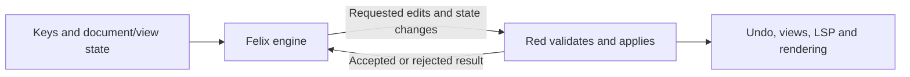

# Optional Helix mode for Red

Build our own optional Helix editing mode for Red. Deliver an extensively tested core that exactly matches the agreed Helix behavior, then begin the broad compatibility milestone immediately after the core passes its acceptance gate.

## In scope

- A new implementation of optional Helix editing in Red.
- Felix, a headless engine in the private, optional `felix-core` workspace crate, with a boundary that permits later extraction as a standalone library, following the user's Vimlet precedent.
- Both milestones apply Helix editing to document windows: files, scratch buffers, and split views. Embedded composers and panel inputs retain their current editing behavior and are a separate follow-up.
- Gate Helix support behind a Cargo feature and runtime editing-mode selection. Initial releases exclude Helix; later releases include it while keeping Vim as the default.
- Maintain a side-by-side behavioral regression suite against the pinned Helix reference, covering Felix's core and applicable production Red integration.
- An iterative plan that makes the selection model, editor integration, and validation approach reviewable before implementation begins.
- Use the reviewed implementation as evidence about risks and behavior. Its design and claimed compatibility are not requirements for the new implementation.

## Agreed delivery direction

**Milestone 1 delivers exact core compatibility with extensive validation.** Core behaviors must match the chosen Helix reference, including the interactions between commands. A smaller command set is a milestone boundary, not permission for approximate behavior inside that set. Binding conflicts are decided individually; each approved difference must be named in the compatibility contract.

The core includes selection-first editing, common motions and counts, Normal/Insert/Select modes, search, delete/change/yank/paste, multiple selections and regex selection, and undo/redo. It must work correctly with Unicode text, buffers and splits, clipboard, mouse input, rendering, LSP changes, and external edits. The command groups below are agreed; the detailed command manifest still needs to specify aliases, variants, and fixtures.

For example, selecting every `foo`, changing all occurrences to `bar`, switching buffers, returning, and undoing with selections restored belongs in this milestone. It must be validated through Red's real editor integration as well as the selection kernel.

**Milestone 2 begins immediately after Milestone 1 passes its acceptance gate.** It expands the implementation toward broad Helix compatibility using the same architecture and correctness standard. The agreed follow-up includes named registers, macros, syntax-aware selections, richer text objects and surrounds, shell filters, and wider command/keymap coverage. Its detailed command manifest remains to be defined.

## Agreed command split

**Milestone 1 covers the daily document-editing groups below, including basic text objects and repeat-last-insert.** The user accepted this split without moving any groups between milestones. Basic text objects and repeat support changing several related pieces of text as part of the core workflow.

These coverage groups are agreed. Helix keys identify the reference behavior; unresolved conflicts with Red still require individual decisions. The final command manifest must enumerate modes, aliases, counts, arguments, cancellation, and interactions for every included command.

| Milestone 1 area | Agreed coverage and remaining detail |
| --- | --- |
| Modes and command input | Normal, Insert, and Select transitions; counts; pending prefixes and character arguments; cancellation. |
| Movement and navigation | Character and word/WORD movement; visual and logical lines; line/file boundaries and line numbers; `f/F/t/T` and repeat-last-motion for included commands; page movement; buffer switching and selection jumplist back/forward. |
| Selection manipulation | Select all and lines; collapse, flip, and normalize direction; add selections above/below; choose, keep, and remove the primary selection; regex select/split/filter; split on newlines; merge and trim. Preserve directed ranges and primary identity through edits. |
| Search | Forward/reverse regex search, next/previous matches, and searching from the selection; correct Normal versus Select behavior, smart-case defaults, cancellation, and search-register state. |
| Basic text objects | Inner/around word, WORD, paragraph, and explicit quote/bracket objects; matching brackets. Syntax-aware objects, closest-pair objects, and surround editing belong to Milestone 2. |
| Editing and clipboard | Insert/append/open-line variants; delete/change with and without yanking; character and yanked-text replacement; yank/paste before/after; indent/unindent, joins, and case conversion. Correct simultaneous edits and default-register behavior; explicit clipboard actions remain distinct from ordinary yank/paste. |
| Insert behavior | Text input, movement, newline, deletion by character/word/to line boundary, auto-pairs, indentation, and smart Tab for the agreed language fixtures; native completion integration with the agreed Insert bindings below. |
| Undo and repeat | Undo/redo with full selection restoration and correct transaction grouping; explicit undo checkpoints; `.` with Helix's last-insert replay semantics, plus repeat-last-motion for the included motion set. |
| Document and Red integration | Open/save/close document workflows using Red's host services; files, scratch buffers, and splits; agreed native UI mappings; selection preservation across focus/buffer changes and rebasing through LSP/plugin/external edits. Retain Red's configured formatting and whitespace rules on save as an explicit compatibility exception. |

The immediate Milestone 2 adds explicit named-register workflows and register insertion, macro recording/playback, syntax-aware objects and selections, surround add/replace/delete, shell filters and output insertion, and the remaining navigation, history, view, selection, and command families. The user also assigned current-document-directory exploration, changed-file navigation, symbol-reference selections, and comment/block-comment toggles to M2. Its detailed manifest remains to be finalized. Embedded text fields remain outside M2 and receive a separate follow-up scope after M2 acceptance.

The reference for this inventory is the pinned [Helix keymap guide](https://raw.githubusercontent.com/helix-editor/helix/25.07.1/book/src/keymap.md) and [default keymap implementation](https://raw.githubusercontent.com/helix-editor/helix/25.07.1/helix-term/src/keymap/default.rs). The mandatory acceptance gate applies to interactions between included commands, not just isolated command examples.

## Feature gate

**Helix support uses a build-time feature gate and explicit runtime selection.** The user chose a staged rollout: exclude Helix from ordinary releases initially, then include it in later releases while leaving it disabled in settings by default.

**Initially, use an opt-in Cargo feature named `helix`, plus a runtime editing-mode setting.** Leave `helix` outside Cargo's default feature set initially. Compile Helix-specific code and any exclusive dependencies only when enabled; shared document, transaction, and rendering infrastructure remains available to Red. A build with the feature still starts in Vim mode unless the user selects Helix.

Use `editing_model = "vim" | "helix"` for runtime selection, retaining the reviewed implementation's spelling. Select one editing model for all document windows at startup; configuration changes take effect after restarting Red. Live switching and mixed Vim/Helix document windows are deferred to a separate proposal after M2. The reviewed implementation's unconditional `felix` module is not a feature gate to reuse as-is. Cargo's [feature mechanism](https://doc.rust-lang.org/cargo/reference/features.html) supports the compile-time boundary.

| Build | Configuration | Behavior |
| --- | --- | --- |
| Initial ordinary release, without `helix` | Default or `editing_model = "vim"` | Existing Vim behavior; Helix engine is excluded. |
| Built with `--features helix` | Default or `editing_model = "vim"` | Existing Vim behavior; Helix is available but inactive. |
| Built with `--features helix` | `editing_model = "helix"` | Helix editing in the agreed document-window scope. |
| Built without `helix` | `editing_model = "helix"` | Report that this build lacks Helix support, with instructions to use an enabled build. Do not silently select a different editing mode. |

**Required validation:** compile and test builds with the feature disabled and enabled, and exercise both editing modes in enabled builds. Include configuration error handling and regressions in ordinary Vim behavior. The required all-features Clippy check remains part of pre-push validation; it does not replace the feature-disabled build check.

Keep the Helix configuration value recognizable in feature-disabled builds so validation can explain the missing capability. Red's configuration loader recovers some invalid fields to defaults; unsupported Helix selection must be handled explicitly rather than disappearing through that recovery path. Fail at startup before editing begins, explaining that an enabled build is required or the user must select Vim.

**The next planned ordinary release after M1 passes its full acceptance gate includes Helix, with Vim still selected by default.** Users can then opt into Helix through configuration without obtaining a different build. Keep feature-disabled builds supported and tested. M2 starts immediately after M1 acceptance, independently of release scheduling; it does not wait for this distribution change.

The release pipeline can explicitly enable `helix` for that later stage. Whether to also add it to Cargo's default feature set is an implementation/distribution detail to settle before that release; runtime opt-in remains the agreed behavior either way.

## Engine architecture

**Implement the headless Helix engine as a private, optional crate in Red's existing workspace.** The user accepted this architecture and wants the option to extract it later, following the same progression as Vimlet. Keep it free of terminal UI, LSP clients, plugins, and filesystem ownership so core behavior can be tested independently. Red is its first consumer, and enabling the root `helix` feature includes the crate. Standalone publication and another editor integration are outside Milestone 1; later extraction timing remains open.

**Call the engine Felix and use `felix-core` as its Cargo package name.** The user accepted both names for the headless Helix counterpart to Vimlet. The existing [`felix` package](https://crates.io/crates/felix) belongs to a Rust terminal file manager, so that exact registry name is occupied. A direct crates.io API lookup found no entry for `felix-core` on 2026-11-03; recheck before any future publication. The editor feature and user-facing editing mode remain named `helix`.

**The engine owns editing behavior; Red owns document storage and host effects.** The engine defines Helix commands, selection transformations, and session transitions. Red supplies document content and layout information, stores the committed view/session state, and owns text mutation, undo history, register storage, clipboard access, and host services. Use one authoritative document and committed selection state, rather than maintaining a second editable document inside the engine.

Each proposed edit identifies its buffer, view, document revision, and originating session/selection generation. Red validates those identities and preflights required host effects before mutation, applies the edits under the intended undo grouping, records full selection metadata, updates affected views, and publishes changes through its existing host paths. Dependent register and repeat/session effects follow the accepted result and Helix's required operation ordering. Rejected operations must not advance repeat/session state or partially apply the intended edit.

Distinguish rejection before mutation from a downstream failure after commit. Once text commits, acknowledge its actual revision and committed selections to Felix even if LSP publication or rendering later fails; report that downstream failure separately. Do not report a committed edit as rejected, leave engine state behind the document, or replay the edit to retry a notification. Include both failure boundaries in protocol and production-path tests.

For the agreed example, selecting every `foo`, pressing `c`, typing `bar`, and pressing Escape produces coordinated edits for the full selection set. The change command preserves the yanked fragments, and Red groups deletion and typing into one undo step with the selection snapshots needed for restoration. Acknowledging each input must not split that undo step. Returning to the buffer and undoing uses the same history and restores the relevant selections.

**Selection retention follows the accepted Helix reference.** Remember the full directed selection set and primary selection for each document/view pair. Returning to a document in the same surviving view restores its selections, while document switching enters Normal mode. An ordinary split of the current document copies its selections and scroll position; closing a view discards its stored selections. Undo restores the transaction's recorded selections into the invoking view and maps other saved views through the edits. These are consequences of the accepted exact-compatibility contract, not new optional product choices. Include them in integration fixtures against the pinned reference.

Red already has transactional replacement accounting, stable buffer/window identities, and edit notifications; the [supporting research](HELIX_IMPLEMENTATION_RESEARCH.md) identifies those reuse points. The private crate enforces the dependency boundary and permits independent core tests, at the cost of defining a small host interface upfront.

**Keep the crate extractable.** Its public API uses editing concepts and opaque host identifiers, not Red's `Editor`, `Buffer`, window types, configuration, actions, or terminal events. Red adapters supply normalized keys, document access, geometry, and typed host-operation results. Core tests must run without building Red. Later extraction should require packaging and integration changes, with the editing API already independent of Red.

## Compatibility reference and mandatory acceptance gate

**Use Helix 25.07.1's default behavior for the agreed command set as the compatibility reference across both milestones.** The user accepted this reference. Pin release commit `a05c151bb6e8e9c65ec390b0ae2afe7a5efd619b`; adopting a newer reference requires an explicit compatibility decision. Native Red interfaces, Red's configured save policy, and individually approved binding differences remain part of our agreed contract. GitHub's latest-release endpoint points to [25.07.1](https://github.com/helix-editor/helix/releases/tag/25.07.1), verified on 2026-11-03.

Every promised command should identify its modes, counts, arguments, effects, and interactions. Existing captures against Helix 25.07.1 remain review evidence; the new implementation needs its own validation. The proposed test setup pins runtime assets, language settings, and environment, and isolates user and project configuration, so that default behavior is reproducible. This choice does not automatically adopt every Helix application setting or expand the agreed command set.

**The following evidence is a mandatory gate before Milestone 2.** The user accepted all eight checks. Every row must pass on the exact Milestone 1 commit. This makes the user's exactness and extensive-testing requirements reviewable; finite tests do not prove every possible interaction.

| Gate | Required acceptance condition | Retained evidence |
| --- | --- | --- |
| Complete agreed coverage | A versioned manifest maps every included command, mode/count variant, pending-input behavior, and composed workflow to meaningful success and applicable boundary/failure cases. Unsupported Helix commands must not fall through into Vim editing. | Command/workflow-to-test manifest and explicit approved differences. No missing, duplicate, stale, or unexplained skipped entries. |
| Trustworthy reference observer | Early in implementation, prove that pinned Helix and Red state can be captured without saving, changing mode, flipping selections, or otherwise altering the observed state. Include intermediate multi-selection insertion and EOF. An instrumented reference must be cross-checked against the released binary. | Small observer feasibility trace, source/binary/configuration hashes, capture schema, and any instrumentation patch. Deliberate capture/comparison faults must be detected. |
| Core correctness and parity | `felix-core` passes invariants, seeded generated sequences, and differential cases for the complete manifest. Compare text, directed ranges, primary selection, mode, relevant registers/repeat state, and undo grouping after each input or defined host-completion boundary. No unexplained differences within the contract. | Reference/candidate snapshots, reproducible seeds, minimized failure regressions, and the comparison report. Include empty text, EOF, Unicode graphemes, CRLF, tabs, adjacent/overlapping selections, and counts. |
| Production integration | Real Red input and incoming edit paths pass multi-selection change/undo/redo, search, clipboard, buffer/split switching, delayed and substantive LSP responses, file reloads, plugin/RPC edits, and stale/rejected operations. | Traces of document/view ownership, selections, actual cursor, host effects, and notifications after each transition. Navigation cases have real destinations. |
| Visible behavior | Frame assertions and focused real-terminal tests verify all cursors/selections, final lines, newline/EOF cells, wrapping, Unicode, scrolling, mouse drag/autoscroll, bracketed paste, and panel focus handoff. | Expected frame cells and retained terminal captures. Internal selection equality alone cannot pass this gate. |
| Optionality and Vim regression | Build/test with Helix excluded, with Helix compiled but Vim selected, and with Helix selected. Test the unsupported-build configuration error. Existing Vim behavior and embedded surface editing must remain correct. | Build/configuration matrix, relevant existing regression results, and required Clippy results, including a feature-disabled check as well as all-features validation. |
| Performance | Capture a clean baseline on a recorded machine/toolchain and fixed workloads before substantial implementation. Measure variability and define budgets early, including new multiple-selection workloads and scaling with document size/selection count. The final candidate must meet those budgets. | Base/candidate commits, corpus hashes, build profile, machine details, timing distributions, and agreed budgets. Set numerical thresholds from measured baselines rather than inventing them during planning or after seeing final results. |
| Reproducible handoff | All preceding rows pass with no unresolved correctness defect in the agreed scope, unexplained parity mismatch, Vim regression, or performance-budget failure. | One acceptance report linking the exact commit, reference/configuration hashes, coverage manifest, results, terminal artifacts, and performance comparisons. Milestone 2 starts immediately afterward under the same gates. |

The [supporting research and validation design](HELIX_IMPLEMENTATION_RESEARCH.md) describes the test layers and pitfalls behind these gates. Representative workflows include select-many → change → type → undo/redo, reversed selections, returning to a buffer in the same view, undo from another split, and an asynchronous edit after focus or selections have changed. The final manifest supplies concrete fixtures and approved binding exceptions.

## Side-by-side behavioral regression suite

**Maintain a permanent suite that runs the same editing scenarios against Helix and Felix.** The user explicitly requested this in addition to accepting the milestone gate. Extend it as Milestone 2 adds behavior, and retain each confirmed bug as a regression case.

**Proposed runner design:** one shared fixture describes initial documents, directed selections, mode, settings, input events, and any controlled host responses. Run it against pinned Helix 25.07.1 and Felix with a minimal test host. Run applicable cases through Red's production input/transaction path as well. This distinguishes a Felix command error from an adapter or editor integration error.

| Comparison | Purpose |
| --- | --- |
| Helix ↔ Felix with a test host | Validate the independent engine's command, selection, register, and history behavior. |
| Helix ↔ Red with Felix enabled | Validate matching behavior through Red's real input, buffer/view, transaction, and host-service paths. |

Compare shared semantic state after every input and declared host-completion boundary: document text, directed selection ranges, primary selection, mode/pending input, relevant registers/repeat state, and history effects. Each fixture declares required observations and applicable hosts. Missing required fields or unsupported runner capabilities must be reported explicitly, not silently removed from comparison.

Input normalization and any coordinate conversion are explicit. For an individually approved binding difference, record each host's event sequence while checking the agreed semantic result. Native Red pickers, panels, gutters, and themes keep their agreed appearance; separate frame/terminal tests validate their actual cursor, selection coverage, and interaction behavior.

On the first divergent event, retain a side-by-side state diff, input prefix, initial fixture, all applicable runner results, version/configuration hashes, and a replay command. Minimize the failing sequence while preserving the same mismatch, and retain the original too. Distinguish semantic mismatches from crashes, timeouts, or reference/infrastructure failures; none may become a passing comparison.

**Require deterministic comparisons on every PR and larger generated runs nightly.** The user accepted this cadence. The PR check covers the deterministic core manifest and fixed generated seeds; the nightly suite explores longer sequences with recorded seeds. Require both the deterministic and agreed extended runs on the exact Milestone 1 handoff commit. Use live runs of the pinned reference; stored snapshots are useful for diagnosis and fast local checks but do not replace the reference comparison. Cache verified reference builds and use explicit completion barriers rather than timing sleeps.

The required conformance check must not silently disappear through the existing CI path-based coverage selection. Keep its result explicit on every PR, and make crashes, timeouts, missing cases, and reference failures fail the check with a distinct diagnosis.

## Key binding decisions

**Conflicting bindings are decided case by case.** There is no blanket rule that Helix or Red wins. Approval of one binding does not settle another.

**`Space f` opens the file picker in Helix mode.** This follows Helix's default. Red's document-format action moves to the agreed `Space =` binding.

**`Space a` invokes code actions in Helix mode.** This follows Helix's default. The core's Helix select-all command remains part of the command inventory; this decision does not preserve Red's select-all action on `Space a`.

**`Space e` opens file exploration in Helix mode.** The user chose Helix's file-explorer binding over Red's Explore prefix, then clarified that we must reuse an existing Red file-browsing surface rather than reimplement Helix's explorer. The Explore command group moves to the agreed `Space o` prefix; [Code explore](EXPLORE.md) documents its child actions.

**Initially, use Red's existing NeoTree sidebar for `Space e`.** The `NeoTree` command in [plugins/neotree.hk](../plugins/neotree.hk) already powers `Ctrl-e`, including the file tree and its search/open workflow. Its current command toggles visibility and focuses the panel when opening. This binding reuses that surface instead of creating another explorer.

### Agreed additional bindings

The user accepted each of these six mappings for Helix document windows. Vim bindings stay as they are. These choices preserve displaced Red actions and resolve only the named conflicts.

| Conflict or displaced action | Agreed Helix-mode behavior | Reason or remaining detail |
| --- | --- | --- |
| Document format displaced by `Space f` | `Space =` invokes Red's existing document formatter. | Keeps `Space f` for the file picker; distinct from Helix's selection-format command. |
| Explore submenu displaced by `Space e` | Move the submenu to `Space o`, preserving its child keys; `Space o e` toggles Explore. | Keeps `Space e` for NeoTree; `Space E` is reserved for the agreed M2 directory-scoped explorer. |
| Statusline manager displaced by `Space s` | `Space l` opens the statusline manager. | Keeps `Space s` for document symbols. |
| `Space p`: clipboard paste versus previous buffer | `Space p` pastes clipboard contents after the selection; `g p` selects the previous buffer. | Both purposes follow Helix's default command locations. |
| `Space P`: clipboard paste versus plugin list | `Space P` pastes clipboard contents before the selection; `Space L` opens the plugin list. | Preserves plugin-list access alongside clipboard behavior. |
| Insert `Ctrl-k`: delete to line end versus signature help | `Ctrl-k` deletes through line end with Helix semantics; `Alt-k` invokes Red signature help. | Applies only to document Insert mode; native embedded inputs keep their existing behavior. |

`Space =`, `Space o`, `Space l`, `Space L`, and Insert `Alt-k` are unassigned in the inspected [Red baseline defaults](https://github.com/codersauce/red/blob/c42adfff6894a589331571ec1e34663f628b82bc/default_config.toml) and [pinned Helix defaults](https://github.com/helix-editor/helix/blob/a05c151bb6e8e9c65ec390b0ae2afe7a5efd619b/helix-term/src/keymap/default.rs). User remappings remain separate from these agreed defaults.

### Agreed window, Git, and Agent bindings

The user accepted all nine rows and their milestone assignments. M2 bindings are reserved during M1 and activate when the corresponding command is implemented. Reserved commands remain explicitly unavailable during M1, without falling through into Vim handlers. Existing Red workflows retain the alternatives listed here.

| Keys or conflict | Agreed behavior | Milestone and preserved Red access |
| --- | --- | --- |
| `Space E` | Open NeoTree at the current document's directory, adapting the existing surface. | M2. Explore remains on agreed `Space o e`. |
| `Space g` | Open changed-file navigation. | M2. Project search remains on agreed `Space /`. |
| `Space G` | Keep Red's Git dashboard. | M1, as an explicit Red-specific exception. This does not add debugger support to either milestone; debugger scope and access remain separate. |
| `Space w` | Open the same window command group as `Ctrl-w`. | M1. Workspace symbols remain on agreed `Space S`. |
| `Space h` | Select references to the symbol, following Helix's command behavior. | M2. Move Git hunk stage/unstage/reset to `Space z s/u/r` in M1. |
| `Space c` / `Space C` | Helix comment/block-comment toggles. | M2. Code actions remain on agreed `Space a`; Git message submit/cancel move to `Space z c/q`; sample inline-comment creation moves to `Space V`. |
| `Ctrl-w H/J/K/L` | Swap adjacent views in the specified direction. | M1. Preserve Red's outer-edge placement under `Ctrl-w e h/j/k/l`. Swapping needs distinct behavior from the existing placement actions. |
| `Ctrl-w n` | Scratch-split prefix: `Ctrl-w n s` creates a horizontal scratch split; `Ctrl-w n v` creates a vertical one. | M1. This replaces Red's immediate horizontal scratch split on `Ctrl-w n`. |
| Normal/Select `Alt-c`, `Alt-s`, `Alt-a`, `Alt-n` | Helix change without yanking and split-on-newline on `Alt-c/s`; reserve `Alt-a/n` for syntax selections. | `Alt-c/s` in M1; syntax selections in M2. Add `Space B t/n/s/c` for Agent toggle/new/sessions/clear in M1. Preserve existing `Space A`, `Alt-m`, and `Alt-w` access. |

The `Space z`, `Space V`, `Space B`, and `Ctrl-w e` namespaces are unused in both inspected default maps and avoid the earlier agreed mappings.

### Agreed final modifier and Insert bindings

The user accepted these four mappings for document windows.

| Keys or conflict | Agreed behavior | Milestone and preserved access |
| --- | --- | --- |
| Normal/Select `Alt-x` | Shrink selections to line bounds using Helix semantics. | M1. Command palette stays on `Space ?` and `Ctrl-Shift-p`. |
| Normal/Select `Alt-e` | Reserve syntax-parent-end movement for M2. Move Red's one-line downward scrolling to `Alt-y`. | M1 retains downward scrolling on `Alt-y` and upward scrolling on `Ctrl-y`; direct `Alt-e` syntax navigation is M2. |
| Insert `Tab` / `Shift-Tab` | `Tab` uses Helix smart Tab; `Shift-Tab` inserts the document's configured indentation string. | M1. Indentation may be spaces or a tab, according to document settings. Completion-menu precedence follows the pinned default. |
| Insert `Ctrl-x` / `Ctrl-Space` | `Ctrl-x` invokes completion; retain `Ctrl-Space` as a Red alias. | M1, using Red's existing completion UI. |

`Alt-y` is unassigned in both inspected default maps. Exact smart Tab requires syntax-parent and snippet-tabstop resolution in M1, even though the dedicated `Alt-e` navigation command is deferred to M2. This is a dependency of already agreed smart-Tab behavior: Red supplies the required syntax/snippet information through the headless interface. Include active completion menus, leading indentation, multiple selections, and snippet navigation in its parity tests. Reference: [smart Tab and indentation insertion](https://github.com/helix-editor/helix/blob/a05c151bb6e8e9c65ec390b0ae2afe7a5efd619b/helix-term/src/commands.rs#L4148).

## Native Red UI: agreed initial mappings

**Initially, reuse Red's existing UI for surrounding application features.** The user accepted the mappings below and the individual conflict resolutions above. Any additional conflict found while completing the command manifest still requires a case-by-case decision.

| Feature | Agreed binding or remaining choice | Existing Red interface to reuse | Required adaptation or open detail |
| --- | --- | --- | --- |
| Find a file | `Space f` | Fuzzy file picker with preview | Document format moves to `Space =`. |
| Browse files | `Space e` | NeoTree sidebar | Explore moves to `Space o`; `Space o e` toggles it. |
| Code actions | `Space a` | Existing code-action picker | Binding agreed; requests must receive the appropriate Helix selection range. |
| Switch buffers | `Space b` | Existing buffer picker | Same broad purpose as current Red binding. |
| Search the project | `Space /` | Existing project-search picker and results panel | Preserve native previews and the results workflow. |
| Document/workspace symbols | `Space s` / `Space S` | Existing LSP symbol pickers | Red's statusline manager moves to `Space l`. |
| Hover documentation | `Space k` | Existing hover popup | References move to the agreed `g r` binding. |
| Find references | `g r` | Existing references picker | M2 adds reference selections on `Space h`; Git hunk actions move to `Space z s/u/r`. |
| Rename a symbol | `Space r` | Existing rename prompt | Preserve existing workspace-edit handling and map Helix selections through the edit. |
| Document/workspace diagnostics | `Space d` / `Space D` | Existing diagnostics picker | Add current-document/workspace scope. Red currently offers all cached diagnostics versus errors only. |
| Find a command | `Space ?` | Existing command palette and key hints | Show effective Helix bindings and pending prefixes. |
| Completion/signature help | Insert `Alt-k` for signature help; `Ctrl-x` and Red alias `Ctrl-Space` for completion | Existing completion and signature-help popups | Insert `Ctrl-k` deletes through line end; `Tab` uses Helix smart Tab and `Shift-Tab` inserts configured indentation. |
| Splits and window focus | `Ctrl-w` and `Space w` groups, with the agreed subcommands above | Existing split layout, borders, and focus handling | Adjacent swapping and outer-edge placement remain distinct commands. |
| Explore, Git, Agent, messages and inline tools | Agreed relocated menus plus preserved nonconflicting access | Existing Red panels and workflows | Explore uses `Space o`, Git helpers use `Space z`, Agent helpers use `Space B`, and `Space G` keeps the Git dashboard. |

These binding choices use the agreed [Helix 25.07.1 reference](https://raw.githubusercontent.com/helix-editor/helix/25.07.1/helix-term/src/keymap/default.rs). Red's existing interfaces are backed by [file picker](../src/ui/file_picker.rs), [NeoTree](../plugins/neotree.hk), [buffer picker](../plugins/buffer_picker.hk), [project search](../plugins/project_search.hk), [symbol/reference pickers](../plugins/lsp_symbols.hk), and the editor's host actions. This table does not settle every command's milestone assignment.

**Reuse the interface while adapting the behavior where needed.** Existing code actions currently use a zero-width cursor range; diagnostics currently lack the proposed document/workspace distinction. Both need integration work despite reusing their UI. View changes, LSP responses, and workspace edits must preserve or transform Helix selections correctly.

UI validation should check correct action, focus, selection preservation, and resulting editor state. Exact core editing parity remains a separate requirement from the appearance and panel layout of native Red host UI.

## Document-window scope across both milestones

**Both milestones cover document windows only: files, scratch buffers, and splits.** This concentrates the compatibility gates on the main editing workflow. Embedded surfaces such as the Agent composer and editable panel inputs retain their current editing behavior throughout M1 and M2.

All agreed native pickers and panels remain available from Helix document windows. Their focus handoff and preservation of document selections still require integration tests; their embedded text fields do not acquire Helix editing in either milestone.

Helix editing in embedded surfaces is a separately scoped follow-up, to revisit after M2 acceptance. This keeps broad document compatibility moving without adding another class of editing surfaces to its gate; no embedded implementation is promised by either milestone.

## Agreed application policies

The user accepted the application policies below.

| Policy | Agreed behavior | Consequence |
| --- | --- | --- |
| External clipboard changes | Use the entire external value whenever it differs from the last successful clipboard yank, including an appended suffix. | Helix 25.07.1 treats a prefix match as unchanged. Red preserves per-selection fragments only on an exact match or a successful yank to a write-only transport. |
| Save behavior | Use Red's configured formatting and whitespace policy in both editing modes. | Record save-policy differences from Helix explicitly and test that save-time edits correctly transform selections and history. Do not change the pinned oracle's defaults to hide the difference. |
| Embedded editing after M1 | Keep M2 focused on document windows; scope Helix editing in composers and panel inputs as a separate follow-up. | Broad document compatibility can proceed immediately without adding a second class of editing surfaces to its gate. Revisit embedded editing after M2 acceptance. |
| Ordinary-release inclusion | Include compiled-in Helix in the next planned ordinary release after the full M1 acceptance gate passes, with Vim still selected by default. | M2 starts immediately after M1 acceptance and does not wait for that release. Feature-disabled builds remain supported and tested. |
| Activation lifetime | Choose one document editing model at startup; configuration changes take effect after restart. | Live switching and mixed Vim/Helix document windows are deferred to a separate proposal after M2. Embedded fields retain their existing model. |

Red already enables formatting on save and defaults to trimming trailing spaces and tabs, with Markdown and Git-commit exceptions. Its file writer writes the resulting buffer without independently adding a final newline. Helix 25.07.1 also enables formatting on save, but defaults to adding a missing final newline and preserving trailing whitespace. Retaining Red's policy is an approved host behavior exception; save tests must name the difference and check Red's configured result. Sources: [Red formatting settings](https://github.com/codersauce/red/blob/c42adfff6894a589331571ec1e34663f628b82bc/src/config.rs#L1138), [Red file writer](https://github.com/codersauce/red/blob/c42adfff6894a589331571ec1e34663f628b82bc/src/buffer.rs#L818), and [pinned Helix editor settings](https://github.com/helix-editor/helix/blob/a05c151bb6e8e9c65ec390b0ae2afe7a5efd619b/book/src/editor.md#L40).

Exact alias enumeration, language fixtures, host protocol types, and measured performance budgets belong in the implementation breakdown. They must satisfy the agreed contract; they are not additional product choices. Unsupported Helix selection in a feature-disabled build should fail at startup with a useful capability error before editing begins, implementing the agreed no-silent-fallback rule.

## Accepted implementation sequence

The complete plan and the following implementation order were accepted. The main dependency is an early complete workflow through Red: prove the reference observer first, then exercise the engine/host boundary before expanding command coverage.

At kickoff, refresh the intended main-branch baseline and create a clean implementation worktree with `wt`. Carry forward the agreed planning documents; do not use the reviewed Helix implementation as the starting implementation. Record the actual base commit, toolchain, and worktree. The inspected `c42adfff` baseline is research context, not a claim about the future main head.

Each stage may contain several reviewable changes. Every stage retains the previously passing comparisons and Vim regressions; a new command is complete only when its relevant engine, production-host, and visible behavior checks pass.

| Stage | Working result and prerequisites | Evidence required to finish the stage |
| --- | --- | --- |
| **1. Reference, coverage, and baseline** | Before changing production editing behavior, freeze the complete M1 requirements registry and explicit exceptions. Enumerate commands, aliases, modes, counts, arguments, cancellation, workflows, and required host observations. Define the shared fixture/capture schema; pin Helix, runtime, language/configuration fixtures, and controlled services. Prove the Helix observer independently of Felix, and record clean Red performance baselines. | Live reference traces include reversed/multiple selections, intermediate Insert, pending input, EOF, buffer changes, and undo. Observing versus not observing preserves the continuation result; injected capture/comparison faults fail at the correct event. Cross-check externally observable behavior with the released binary. Retain hashes, replay instructions, workload measurements, and an explicit report that candidate compatibility is not yet established. |
| **2. Optional Felix foundation** | After stage 1 defines the comparison contract, add the private `felix-core` crate and `helix` feature, startup selection, and explicit unavailable-build error. Establish directed selections, primary identity, grapheme/coordinate boundaries, edit mapping, and the typed host request/acknowledgement protocol. Use a minimal host to exercise revision, view, session-generation, and undo-group contracts. | Independent core invariants cover empty/EOF, Unicode, CRLF, reversed and adjacent ranges, and mapping through shrinking/growing edits. Accepted and rejected operations have the expected atomic effects. Feature-off Vim, feature-on Vim, and the initial Helix path pass their applicable checks; required observations are real or explicitly unavailable. Broad commands remain visibly unfinished. |
| **3. First complete Red workflow** | Build on stage 2 to implement a small path through real Red input, transactions, storage, and rendering: select multiple matches, change them, type, escape, switch buffers, return, undo, and redo. Add same-document splits and undo from another view. Establish the Insert transaction lifecycle, register ordering, per-view retention, a non-mutating Red observer, minimal external-edit mapping, and visible selections/cursors now. | The shared trace agrees across pinned Helix, Felix's minimal host, and Red where applicable, after every input or completion barrier. One change plus typing is one undo step; undo restores the invoking view's recorded selections and maps the others. A real inbound edit rebases affected views once; stale requests preserve committed state. Frame checks include newline/EOF cursors. Measure multi-selection scaling and set budgets before broad command implementation. |
| **4. Complete core command families** | Extend the proven path in coherent groups: motion and selection; search and regex selections; basic text objects; editing, registers, and clipboard; undo checkpoints and repeat. Implement the full agreed M1 variants, prefixes, counts, cancellation, and binding exceptions. Add real production-path cases as each family lands. | Every newly claimed family passes live reference comparisons, meaningful success/boundary/failure cases, and compositions such as motion → selection → change → undo. Fixed seeds and minimized regressions remain required. Unsupported/reserved commands cannot fall through to Vim. M2-only families remain explicitly reserved. |
| **5. Exact Insert and native host services** | Complete auto-pairs, indentation, smart Tab, configured Shift-Tab indentation, completion/snippets, signature help, and their repeat/history interactions using stage 3's lifecycle. Supply syntax-parent and snippet-tabstop capabilities before claiming smart Tab. Adapt all agreed M1 native UI actions, diagnostics scopes, code-action ranges, window operations, and save behavior. | Fixtures cover leading indentation, active completion menus, syntax and snippet navigation, multiple selections, cancellation, and delayed responses. Realistic controlled LSP responses exercise destinations and edits, not just empty results. Native panels preserve document state across focus changes. Save cases verify the approved Red policy and selection/history mapping. All M1 bindings and displaced Red actions have working destinations. |
| **6. Complete integration and stress coverage** | Expand the rendering, external-edit, and terminal coverage introduced in stage 3: LSP/workspace edits, plugin/RPC edits, reloads, wrapping, Unicode, final lines, mouse drag/autoscroll, bracketed paste, scrolling, and panel focus. Exercise large documents and many selections. Finish the full feature/Vim/embedded-surface regression matrix and the release-build configuration. | Frame assertions, real-terminal captures, and substantive service/edit-producer traces cover the complete required matrix. Selection, cursor, history, publication, and ownership remain consistent through asynchronous and cross-view changes. Previously calibrated performance budgets pass; this stage confirms them rather than setting thresholds around the finished candidate. |
| **7. M1 acceptance and M2 handoff** | After stages 1–6, audit the full manifest against every accepted command and workflow, then run the complete eight-part gate on the exact M1 candidate. Prepare the acceptance report and the first M2 work items. | All M1 requirements are implemented and covered; deterministic and agreed extended generated runs pass on the same commit, with no unexplained mismatches, missing observations, correctness defects, Vim regressions, or budget failures. Record all hashes and replayable evidence. M2 starts immediately after acceptance; the next planned ordinary release includes Helix with Vim still selected by default. |

### First complete workflow

Stage 3 is deliberately small enough to expose the ownership and history risks before the full command set exists. Start with a real document containing several `foo` matches. Use production key events to select the document and submit a regex-selection prompt, press `c`, type `bar`, press Escape, switch to another document and back, then undo and redo. Include prompt completion and cancellation; do not seed selections directly in this main integration trace. Capture intermediate Insert state rather than checking only the final text.

Repeat with reversed selections, adjacent matches, an unterminated last line, and a second view of the document. Include undo from the second view and a controlled inbound edit while another view has saved selections. The implementation may use a narrow subset of commands, but those commands, the visible selections, and their transaction lifecycle must be correct throughout the trace. Finish the smart-Tab and completion breadth in stage 5 without replacing this lifecycle.

Stages 2–3 also exercise rejection before mutation and failure after a committed edit. For the latter, the acknowledgement must still synchronize Felix to the committed document and selections, while the downstream error is reported separately. Retrying publication must not duplicate the text change or create another undo step.

### Required checks during construction

Keep a complete requirements registry from stage 1 and a separate executable manifest of implemented behavior. Planned requirements remain explicitly listed as incomplete; they are not skipped tests or passing comparisons. Each implementation change activates its requirements and runs every applicable active case against the live reference, alongside earlier regressions and manifest consistency checks. Removing an active requirement requires an explicit scope change.

The required PR result reports both active conformance and remaining M1 work. A green intermediate PR does not claim full M1 compatibility. Nightly generated runs exercise the active behavior with retained seeds. Stage 7 requires the executable manifest to cover the entire accepted M1 registry with no planned entries left; afterward that full manifest stays required on every PR. The existing path-based CI selection must not suppress this result.

Shared-workflow performance baselines are captured in stage 1 before implementation. Early kernel and production traces add measurements for Felix-specific multi-selection workloads in stages 2–3; use those results and observed variability to set explicit budgets before stage 4 expands behavior. Retain the measured baseline, budget rationale, and repeated timing distributions. No numerical threshold is invented during planning.

The observer remains an early feasibility risk until stage 1 proves it. If required state cannot be captured reliably, resolve the instrumentation or revise the approach before expanding implementation; do not substitute fabricated fields, destructive probes, or a weaker comparison contract. Later Red observer work must satisfy the same non-mutation checks when stage 3 introduces the candidate path.

### Milestone 1 acceptance candidate

Use the [candidate acceptance record](HELIX_M1_ACCEPTANCE.md) to verify the eight gates against the revision being handed off. The workstation and Linux comparisons use the same pinned Helix release.

### Implementation and validation sequence

The reported ordinary typing and cursor-movement slowdown takes priority in the performance work. The [Helix performance plan](HELIX_PERFORMANCE_PLAN.md) defines the input-to-frame and scaling gates. The [workstation acceptance report](HELIX_PERFORMANCE_RESULTS.md) records the passing local comparisons and the original signature-help compatibility finding. The candidate includes a terminal reproduction and a language-server regression for that trigger.

Starting from `e91d6017`, keep the remaining changes on the local Felix branch in small, tested commits. The next planned push is the M1 acceptance candidate. Use the following order for the remaining work.

1. **Audit the acceptance evidence.** Map the agreed command and host workflows to executable cases and identify missing observations. Reconcile the coverage inventory with all eight gates above. Locate the original performance baselines, workloads and budgets before measuring the candidate. Record any missing baseline evidence explicitly.
2. **Finish editing and command state.** Verify multi-selection yank, paste and replace across clipboard transports, including an external clipboard change and provider failure. Close the remaining counts, aliases, repeated motions and pending-input cases. Exercise focus or document changes between a prefix and its argument.
3. **Finish layout and Insert behavior.** Compare movement and search with inline text, projected Markdown and mixed line endings. Verify language-specific indentation, joins and smart Tab. Cover completion previews in splits, nested and mirrored snippet stops, multiple accepted completions, and counted repeat after switching documents.
4. **Run the host and acceptance checks.** Exercise substantive LSP, plugin and reload edits, stale requests, mouse and panel handoff, and Red's save policy. Run the full Vim and feature matrix, deterministic and extended reference comparisons, terminal checks, Clippy and performance workloads. Keep the seeds, failures and minimized regressions. Arrange for both deterministic and extended Linux comparisons to run on the candidate revision before handoff.
5. **Hand off one candidate.** Request a push of the accumulated commits after the local checks pass. Record which checks used the local dependency mirror. Verify the pushed SHA, follow Linux CI using the repository lockfile, and finish the acceptance report against that SHA. A Linux-only defect may require a corrective push. Start M2 with named registers and register insertion once all eight M1 gates pass.

During this stint, provide progress updates as work lands. Request an earlier handoff only for a decision outside the agreed scope or a specific acceptance check that genuinely requires the user's environment.

### Immediate broad-compatibility follow-up

Prepare the M2 inventory while closing M1, but begin its implementation only after the M1 gate passes. The first M2 group is explicit named registers and register insertion, followed by macros using the already-tested command/replay and host protocol. Continue with syntax selections/objects and closest-pair/surround editing; shell filters and output insertion; then the remaining navigation, history, view, and native-host command families.

The first register change has four testable parts, in this order:

| Part | Reference and Red checks |
| --- | --- |
| Selection and lifetime | Record the pending `"` prompt, the chosen register, cancellation, a count and the next command in Normal and Select modes. Check when a motion consumes the choice and what happens across a document switch. |
| Storage | Yank two different fragments into `a`, write separately to `A`, then overwrite `a`. Check both slots and the unnamed register after each key. Paste into fewer and more selections, then undo. |
| Insertion | Use Insert `Ctrl-r` with populated and empty slots, multiline text and multiple cursors. Check Escape during the prompt, repeat, and the undo boundary. Compare the displayed prompt and final terminal frame. |
| Host-backed registers | Exercise the black hole, selection numbers, selected text, document path, search history, and both clipboard providers. Compare read-only write errors and provider failure against the pinned reference. Retain Red's agreed handling of externally edited clipboard contents. |

The first register slice, `52aa8438`, passed Linux with the committed lockfile. Its artifact contains 232 register inputs, 4,044 fixed M1 inputs and 4,676 extended inputs. [Linux conformance run](https://github.com/codersauce/red/actions/runs/41887329947)

The second register slice adds named search histories, copying between registers, and the primary-selection clipboard. The dedicated corpus now compares 366 inputs across 16 cases. The macro slice implements document recording with `Q` and counted replay with `q`, including nested register calls. It adds 230 differential inputs across 17 cases and a paired terminal test spanning two documents. The next group is syntax-aware selections and text objects, followed by closest-pair and surround editing. [Register comparison instructions](../scripts/felix/README.md#m2-register-comparisons)

Include the already reserved M2 bindings and actions in that inventory: current-document-directory NeoTree, changed-file navigation, symbol-reference selections, comment toggles, and syntax navigation/selections. Each group extends the same manifest, live differential suite, production integration, and visible-behavior checks. Independent groups may proceed concurrently once their prerequisites exist. M2 remains scoped to document windows; release scheduling does not delay it.

## Implementation handoff

Begin with the reference observer and clean Red baseline. The first production editing workflow follows in stage 3.

Concrete command/fixture files, host protocol types, reference instrumentation, and numerical performance budgets are implementation deliverables assigned to the stages above. Their absence during planning is not evidence that the corresponding acceptance checks have passed.
