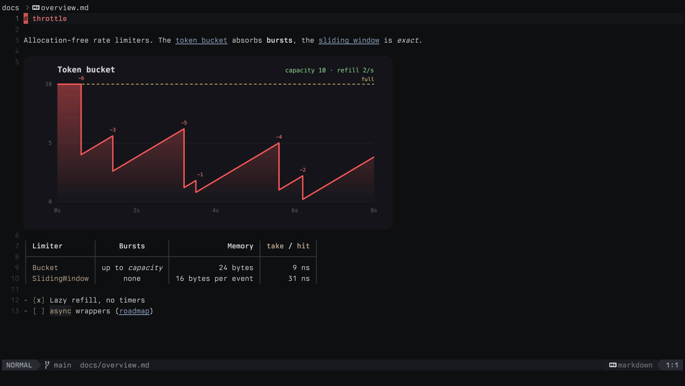

# Markdown

Red reads Markdown the way it looks once rendered, and edits it as the source it
is. In Normal mode, tables are drawn as grids, link and emphasis markup is
hidden, and images appear in the buffer. Move onto a line to edit it, and that
line shows its raw Markdown again. None of this changes the file or adds undo
entries.



Try it with the sample that ships in the repository:

```shell
red examples/markdown-images/sample.md
```

## Tables

Pipe tables show as aligned grids with wrapped cells, column alignment, and
inline formatting. Enter Insert or Visual mode in a table to reveal its source;
Escape restores the grid.

`:markdown-tables` (also in the command palette) toggles grids in the current
split. Set `markdown_tables = false` to start in source. Fenced code, nested
tables, malformed rows with extra cells, and documents larger than 2 MiB stay
in source form.

## Hidden markup

With wrapping on, link destinations and brackets, emphasis markers, image
markup, and code-span backticks take no space on screen. A paragraph full of
links shows only their labels and wraps on the words you can see, and `gj` and
`gk` move over those visible rows.

The text is still the source underneath. Insert, Visual, search, and pending
operators show the cursor line raw, and moving the cursor into hidden syntax
reveals that line, so the character under the cursor is always the one an
edit changes. Code fences, escapes, and link reference definitions are never
hidden.

`:markdown-conceal` toggles this in the current split. Set
`markdown_conceal = false` to keep all markup visible.

Bold, emphasis, inline code, and links are highlighted either way, including
nested formatting, reference links, and URL or email autolinks.

## HTML

Raw HTML is highlighted with the bundled HTML grammar. Block tags such as
`<details>` and `<div>`, and inline tags such as `<kbd>`, use the same tag,
attribute, and string scopes as an `.html` file. A fenced `html` block is
highlighted the same way, so Markdown does not need an HTML language pack.
HTML written inside another language's fence stays that language.

## Images

A line that holds only an image becomes the picture itself in Normal mode:

```markdown

```

Local paths are relative to the Markdown file, and `https` images are
downloaded; either way an image can be up to 8 MB. Height follows the image's
proportions, up to `markdown_image_max_height` rows (16 by default).

Move onto the image line and its Markdown appears in the block's first row,
with the picture still below it, so nothing under the image moves. `j` and `k`
step onto that line and then past the picture. Counts, half-page motion,
`gg`/`G`, and the mouse wheel never stop inside an image. An image scrolled
partly off screen is cropped, not squashed, and a popup drawn over an image
covers it cleanly.

### Terminal support

`markdown_images = "auto"` asks the terminal what it can draw and uses the best
answer:

| Terminal | What you see |
| --- | --- |
| Kitty, Ghostty, WezTerm, Konsole | Full-resolution images (Kitty graphics) |
| iTerm2, VS Code | Full-resolution images (iTerm2 protocol) |
| foot, mlterm, Windows Terminal, other Sixel terminals | Full-resolution images (Sixel) |
| Other truecolor terminals | A smoothed picture drawn with block characters |
| Anything else | `[image: alt (path)]` |

Inside Herdr or Zellij 0.45+, images reach a capable outer terminal directly.
In tmux they need passthrough (`set -g allow-passthrough on`); without it Red
uses block characters. GNU screen always gets block characters.

To choose for yourself, set `markdown_images` to `"kitty"`, `"iterm2"`,
`"sixel"`, `"halfblocks"`, or `"off"` (the placeholder only).

## Tasks

List markers and task checkboxes keep their source characters and indentation.
In Normal mode, press `gT` anywhere on a task's first line, or choose **Toggle
task** in the command palette, to switch between `[ ]` and `[x]`. Nested tasks
and tasks in block quotes work; code examples are left alone. Each toggle keeps
the cursor in place and is one undo step. Bind `ToggleMarkdownTask` to use
another key.

## Links

Press `gx` on a link's label or destination, or choose **Follow link** in the
command palette:

- Web links open in your browser and email links in your mail app.
- Local files open in Red relative to the Markdown file, reusing open buffers
  and their unsaved edits.
- `#heading` and `guide.md#heading` jump to headings; duplicate headings use
  `-1`, `-2`, and so on.
- `src/main.rs:42:3` and `src/main.rs#L42` jump to a line and column.

`Ctrl-o` and `Ctrl-i` go back and forward. Reference links, autolinks, and
links inside rendered tables work the same way. A missing target leaves you
where you are.

### Reading with a split

Press `Ctrl-w x`, or choose **Open link in split**, to keep the document visible
while a local link opens in a split to its right. Later `gx` and `Ctrl-w x`
from that document reuse the same split, and a `[links → N]` marker in the
file name shows which pane it is. The split has its own `Ctrl-o`/`Ctrl-i`
history.

Focus stays in the document. Set `markdown_link_split_focus = "target"` and
restart to move focus to the opened file. **Clear link destination** in the
command palette lets go of the split without closing it, and closing either
pane or switching the document to another file does the same.

## Settings

| Setting | Default | Effect |
| --- | --- | --- |
| `markdown_tables` | `true` | Draw pipe tables as grids |
| `markdown_conceal` | `true` | Hide inline markup while wrapping |
| `markdown_images` | `"auto"` | How to draw images: `auto`, `kitty`, `iterm2`, `sixel`, `halfblocks`, `off` |
| `markdown_image_max_height` | `16` | Most rows one image may use |
| `markdown_link_split_focus` | `"source"` | Pane that keeps focus after `Ctrl-w x` |

Tables, images, links, and tasks apply to Markdown documents up to 2 MiB.
